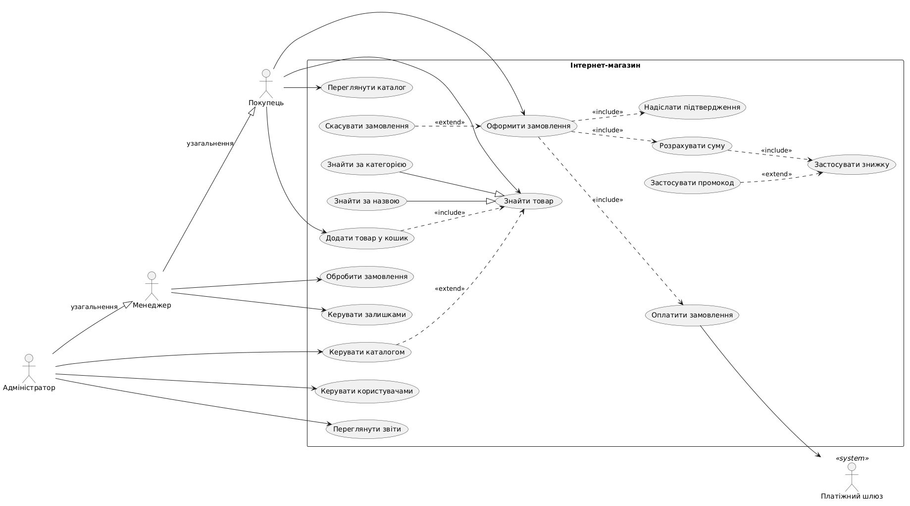
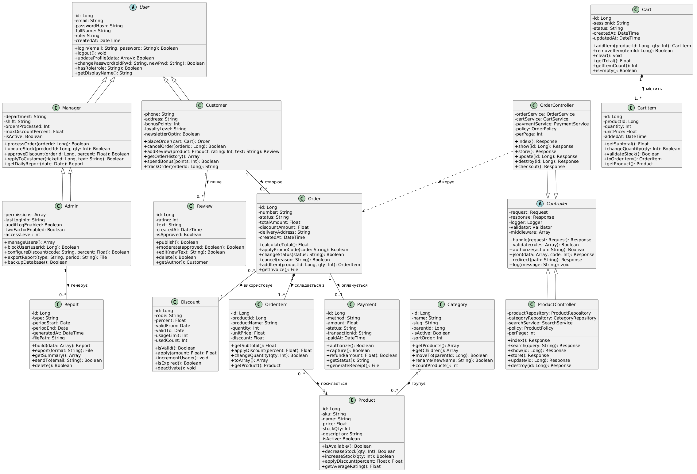

# Архітектура системи «Інтернет-магазин»

Навчальний проєкт дисципліни «Технології розробки програмного забезпечення». Документ описує предметну галузь, акторів, MVC-архітектуру (майбутній Laravel-стек), сутності БД, три варіанти Use Case та UML-діаграми. Реалізація коду — у наступних лабораторних (3–5).

---

## 1. Предметна галузь

**Призначення:** продаж товарів через веб-вітрину з онлайн-оплатою, доставкою та обліком залишків.

**Межі системи:** система веде каталог, кошик, замовлення, оплату через зовнішній платіжний шлюз і формує звіти для персоналу. Логістика перевізника (маршрути, ТТН) та бухгалтерський облік поза межами — система лише передає дані для доставки та експортує звіти.

**Основні бізнес-процеси:**

1. Перегляд каталогу та пошук товару.
2. Оформлення та оплата замовлення.
3. Обробка замовлення менеджером (статуси, залишки).
4. Адміністрування каталогу, користувачів і звітності.

### Паспорт системи

| Параметр | Значення |
|---|---|
| Призначення | онлайн-продаж товарів із доставкою та оплатою |
| Основні функції (≥5) | каталог і пошук; кошик; оформлення замовлення; онлайн-оплата; відстеження статусу; відгуки; адмін-керування каталогом і звітами |
| Актори | Покупець, Менеджер, Адміністратор; зовнішній **Платіжний шлюз** |
| Архітектура | MVC (Laravel): Model = Eloquent, View = Blade, Controller = HTTP-обробники |
| Сценарії (≥3) | оформлення замовлення; скасування замовлення; обробка замовлення менеджером |
| Логічні сутності (≥5) | User, Customer, Manager, Admin, Category, Product, Cart, CartItem, Order, OrderItem, Payment, Discount, Review |
| Таблиці БД (≥5) | `users`, `categories`, `products`, `carts`, `cart_items`, `orders`, `order_items`, `payments`, `discounts`, `reviews` |
| Вихідні дані (≥3) | рахунок/чек замовлення (PDF); звіт продажів за період; звіт залишків на складі; ТОП товарів (графік) |

---

## 2. Актори та функції

| Актор | Мета | Основні функції |
|---|---|---|
| **Покупець** | придбати товар | перегляд каталогу, пошук, кошик, оформлення замовлення, відгуки |
| **Менеджер** | обробити замовлення | зміна статусів, залишки, звернення клієнтів |
| **Адміністратор** | керувати системою | користувачі, каталог, знижки, звіти |
| **Платіжний шлюз** | прийняти оплату | авторизація та підтвердження транзакції (зовнішня система) |

**Функції системи (дієслова):** керувати каталогом; шукати товари; додавати в кошик; розраховувати суму зі знижкою; оформлювати замовлення; оплачувати через шлюз; обробляти замовлення; формувати звіти.

---

## 3. Архітектура (MVC)

| Шар | Що містить | Приклад |
|---|---|---|
| **Model** | Eloquent-моделі, зв'язки, бізнес-правила | `Order`, `Product`, `OrderItem` |
| **View** | Blade-шаблони | `resources/views/catalog/index.blade.php` |
| **Controller** | приймає запит, валідує, викликає сервіс, повертає відповідь | `OrderController@store` |
| **Service** (додатково) | складна логіка (оплата, знижки) | `PaymentService`, `OrderService` |

Потік запиту: браузер → маршрут → middleware → контролер → сервіс/модель → view або JSON.

---

## 4. Сутності та таблиці БД

| Сутність | Таблиця | Ключові поля | Зв'язки |
|---|---|---|---|
| User | `users` | id, email, password, role | 1:N → Order |
| Category | `categories` | id, name, slug, parent_id | 1:N → Product |
| Product | `products` | id, sku, name, price, stock_qty, category_id | N:1 Category; 1:N Review |
| Cart | `carts` | id, user_id/session_id, status | 1:N CartItem (композиція) |
| CartItem | `cart_items` | id, cart_id, product_id, qty, unit_price | N:1 Cart, N:1 Product |
| Order | `orders` | id, number, status, total, user_id | 1:N OrderItem; 0:1 Payment; N:M Discount |
| OrderItem | `order_items` | id, order_id, product_id, qty, price | N:1 Order (композиція) |
| Payment | `payments` | id, order_id, amount, status, transaction_id | N:1 Order |
| Discount | `discounts` | id, code, percent, valid_from/to | M:N Order |
| Review | `reviews` | id, product_id, user_id, rating, text | N:1 Product, N:1 Customer |

---

## 5. Use Cases (три форми)

### 5.1 Коротка форма — «Переглянути каталог товарів»

Покупець відкриває головну сторінку магазину, система показує список категорій і популярні товари. Покупець обирає категорію, система виводить посторінковий список товарів із назвою, ціною, наявністю та фото. Покупець відкриває картку товару й отримує детальний опис, характеристики та відгуки. Сценарій завершується переходом до кошика або поверненням до каталогу.

### 5.2 Поверхнева форма — «Знайти товар»

- **Головний сценарій:** покупець вводить запит у поле пошуку → система шукає за назвою, SKU та описом → виводить результати, відсортовані за релевантністю → покупець відкриває потрібний товар.
- **Альтернатива 1:** нічого не знайдено — повідомлення, суміжні категорії, очищення фільтрів.
- **Альтернатива 2:** пошук за фільтрами (ціна, бренд, наявність) без перезавантаження.
- **Альтернатива 3:** запит коротший за 2 символи або містить недопустимі символи — підказка, пошук не виконується.
- **Альтернатива 4:** товар знято з продажу — перегляд без «У кошик».
- **Альтернатива 5:** збій індексу — порожній результат, запис у лог, «Спробуйте пізніше».

### 5.3 Повна форма — «Оформити замовлення»

| Розділ | Опис |
|---|---|
| **Use Case Name** | Оформити замовлення (Place Order) |
| **Scope** | System — веб-система інтернет-магазину |
| **Level** | User-goal |
| **Primary Actor** | Покупець (Customer) |
| **Stakeholders and interests** | Покупець — швидка покупка без помилок; Менеджер — коректне замовлення з оплатою; Власник — облік продажів; Платіжний шлюз — валідні платіжні дані; Доставка — повна адреса |
| **Preconditions** | кошик не порожній; товари в наявності; покупець автентифікований або гість з email |
| **Success guarantee** | замовлення створене (`paid`/`pending`), оплата підтверджена або післяплата, залишки зменшені, лист із номером |
| **Main Success Scenario** | 1. Покупець відкриває кошик. 2. Система показує позиції та суму. 3. Покупець змінює кількість або видаляє позиції. 4. Система перераховує суму. 5. Покупець натискає «Оформити». 6. Система перевіряє залишки й авторизацію. 7. Покупець вводить адресу та контакти. 8. Система пропонує доставку й оплату. 9. Покупець обирає способи та підтверджує. 10. Система створює `Order`, переносить позиції в `OrderItem`, резервує товар. 11. Система ініціює оплату через шлюз. 12. Шлюз підтверджує транзакцію, фіксується `Payment`, статус `paid`. 13. Система надсилає лист-підтвердження. 14. Покупець бачить сторінку «Дякуємо, замовлення №…». |
| **Extensions** | **3a.** Кількість перевищує залишок — підсвітка, зменшити або видалити. **5a.** Скасування оформлення — повернення до кошика. **7a.** Некоректна адреса/email — валідація. **9a.** Промокод — UC «Застосувати знижку». **11a.** Оплату відхилено — `payment_failed`, повтор. **11b.** Timeout шлюзу — `pending`, черга менеджера. **12a.** Оплата після скасування — refund. **13a.** Лист не надіслано — повтор з черги. |
| **Special Requirements** | ≤ 3 екранів оформлення; API ≤ 2 с (90 %); HTTPS; сума на сервері; mobile ≥ 360 px |
| **Technology and Data Variations** | картка / Apple Pay / післяплата; кур'єр / самовивіз / поштомат; знижка фіксована або % |
| **Frequency of Occurrence** | ~70 % сесій покупців |

---

## 6. Діаграма варіантів використання

Джерело: `use-case-diagram.puml`.

**Типи зв'язків на діаграмі:**

| Тип | Приклад |
|---|---|
| association | `Customer` → «Переглянути каталог» |
| generalization (актори) | `Admin` → `Manager` → `Customer` |
| generalization (UC) | «Знайти за категорією» → «Знайти товар» |
| include | «Оформити замовлення» include «Оплатити замовлення» |
| extend | «Застосувати промокод» extend «Застосувати знижку» |

---

## 7. Діаграма класів

Джерело: `class-diagram.puml`. На діаграмі **16** доменних/контролерних класів; у кожного ≥5 атрибутів і ≥5 операцій з типами.

**Легенда відношень:**

| Тип | Приклад | Сенс |
|---|---|---|
| наслідування | `Customer` → `User`, `Admin` → `Manager` | ролі розширюють базового користувача |
| асоціація | `Customer` — `Review`, `Order` — `Discount` | рівноправні об'єкти, 1:N / M:N |
| агрегація | `Category` ◇— `Product` | товар може існувати без категорії |
| композиція | `Order` ◆— `OrderItem`, `Cart` ◆— `CartItem` | позиція без замовлення/кошика не має сенсу |

---

## 8. Відповідність Laravel (проєкція на лаб. 5)

| Клас UML | Eloquent-модель | Таблиця | Зв'язок у коді |
|---|---|---|---|
| User / Customer / Manager / Admin | `User` (ролі або STI) | `users` | `hasMany(Order::class)` |
| Category | `Category` | `categories` | `hasMany(Product::class)` |
| Product | `Product` | `products` | `belongsTo(Category::class)` |
| Cart / CartItem | `Cart`, `CartItem` | `carts`, `cart_items` | `hasMany(CartItem::class)` |
| Order / OrderItem | `Order`, `OrderItem` | `orders`, `order_items` | `hasMany` / `belongsTo` |
| Payment | `Payment` | `payments` | `belongsTo(Order::class)` |
| Discount | `Discount` | `discounts` | `belongsToMany(Order::class)` |
| Review | `Review` | `reviews` | `belongsTo(Product::class)` |
| OrderController, ProductController | HTTP-контролери | — | `extends Controller` |

---

## 9. Вихідні дані

| Форма | Призначення | Споживач |
|---|---|---|
| PDF-рахунок / чек | підтвердження оплати та склад замовлення | Покупець |
| Звіт продажів за період | таблиця сум і кількості | Адміністратор |
| Звіт залишків | поточні stock_qty по SKU | Менеджер |
| Графік ТОП-товарів | візуалізація лідерів продажів | Адміністратор |

---

## 10. Файли в каталозі `docs/`

| Файл | Опис |
|---|---|
| `architecture.md` | цей документ |
| `use-case-diagram.puml` / `.png` | діаграма варіантів використання |
| `class-diagram.puml` / `.png` | діаграма класів |

Оновлення: лабораторна робота №2, гілка `feature/system-design`.
